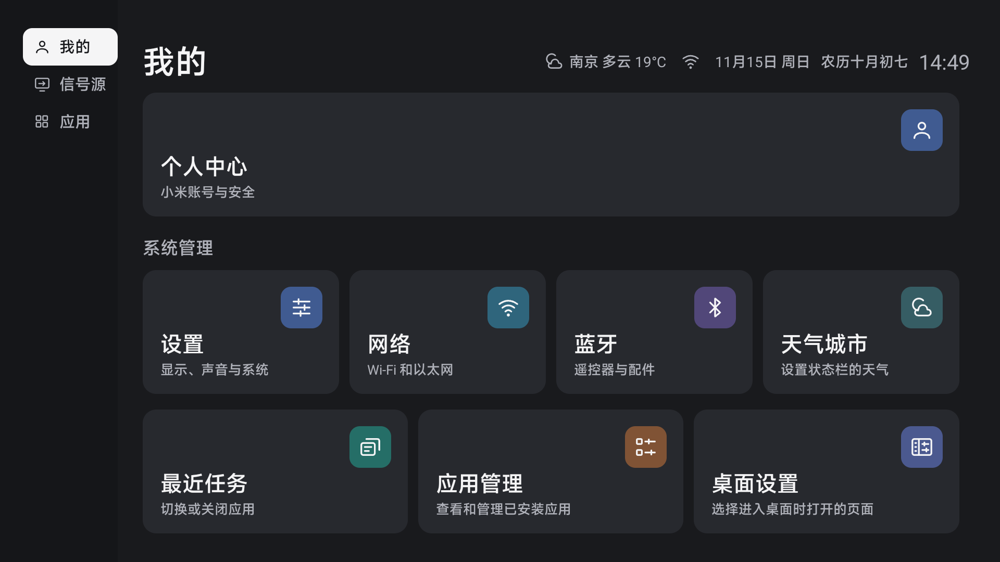
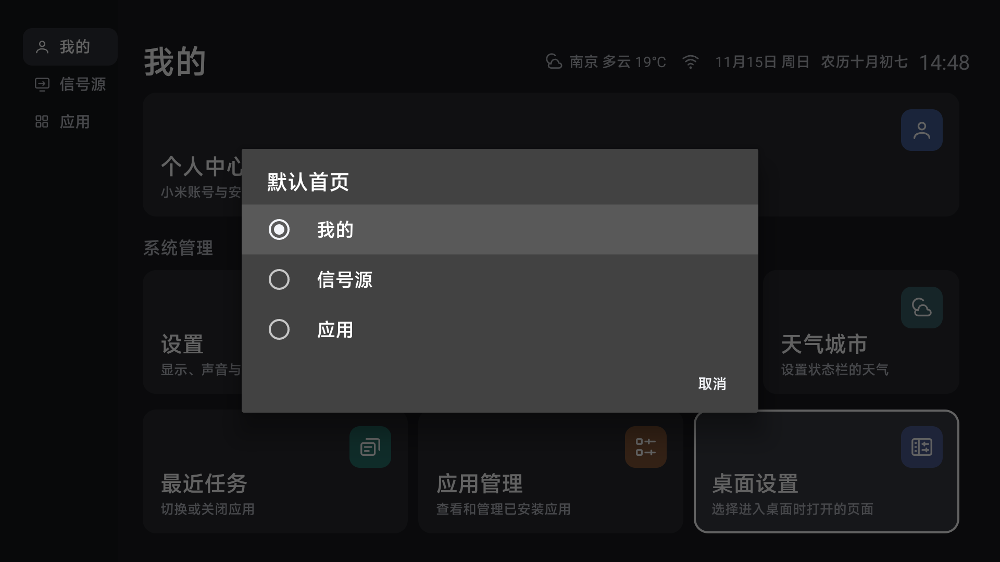
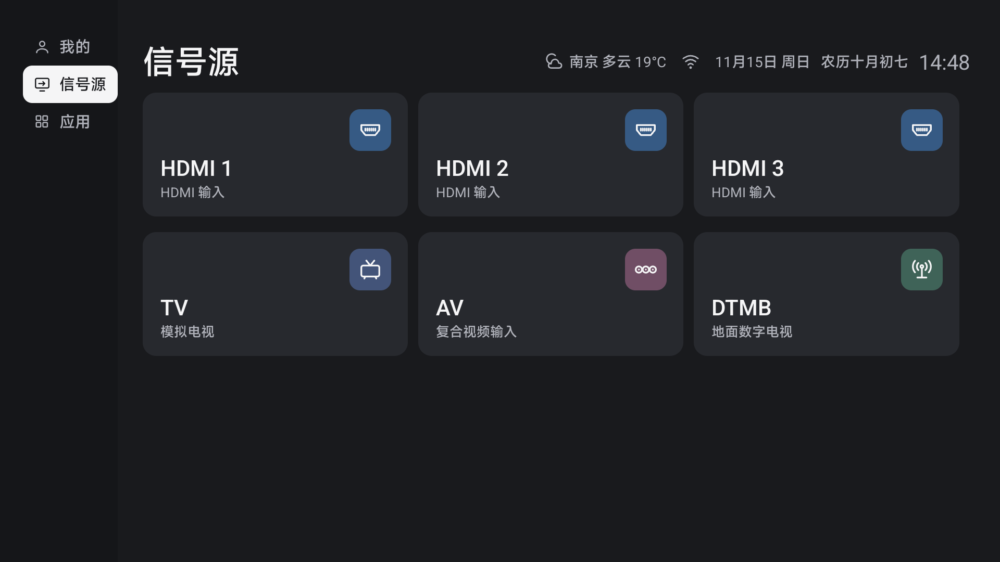
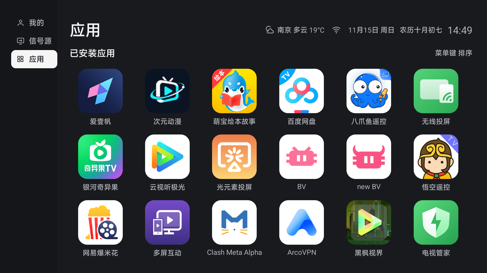

# 简洁电视桌面

简洁电视桌面（Simple TV Home）是面向小米电视的 Android TV 启动器。用遥控器就能在「我的」「信号源」「应用」之间切换，常用设置和电视输入都可以从桌面打开。

[下载 v1.3.6 APK](https://github.com/Android-Modules/simple-tv-home/releases/download/v1.3.6/TVHome-1.3.6.apk) · [查看版本记录](https://github.com/Android-Modules/simple-tv-home/releases)

## 实机截图

| 我的 | 默认首页设置 |
| --- | --- |
|  |  |

| 信号源 | 应用 |
| --- | --- |
|  |  |

## 功能

- 从 **「我的」** 打开个人中心、系统设置、网络、蓝牙、应用管理和最近任务。在「桌面设置」里选择默认首页，进入桌面时会打开选定页面。
- **「信号源」** 集中显示 HDMI 1–3、模拟电视、AV 和 DTMB。检测到已挂载的可移动存储时，还会显示 USB 入口。
- **「应用」** 以圆角图标展示已安装的可启动应用，支持用遥控器调整顺序。
- **状态栏** 显示时间、公历、农历、网络连接和天气。天气支持自动识别城市，也可以在「我的 → 天气城市」里手动搜索。
- 启用 **「简洁桌面快捷入口」** 后，短按 Home 进入默认首页，长按 Home 打开系统最近任务。在「我的」或「信号源」页按菜单键可调出快捷面板。

## 安装与启用

1. 从 [v1.3.6 发布页](https://github.com/Android-Modules/simple-tv-home/releases/tag/v1.3.6) 下载 `TVHome-1.3.6.apk`。可通过 U 盘用电视的文件管理器安装，或通过 ADB 安装。
2. 安装后，从电视的应用列表打开「简洁桌面」。进入「我的 → 桌面设置」，选择「我的」「信号源」或「应用」。选项会自动保存。
3. 如需用 Home 键返回简洁桌面，在电视的无障碍设置中启用「简洁桌面快捷入口」。如果系统提供默认桌面的选择项，也可以将「简洁桌面」选为默认桌面。

电视已经通过 ADB 连接时，可用下方命令安装或覆盖更新。覆盖更新需要 APK 与已安装版本使用相同的签名证书。

```bash
adb install -r TVHome-1.3.6.apk
```

APK 的最低要求为 Android 8.0（API 26）。本版本在小米电视 `MiTV_MFTR0`（Android 14）上验证了首页选择和短按、长按 Home。开机进入桌面的行为、信号源切换及小米系统入口取决于具体机型和固件。

## 给应用排序

1. 打开「应用」，按遥控器的菜单键进入排序模式。
2. 将焦点移到要调整的应用，按确定键选中，再用方向键移动。
3. 再按确定键放下并保存。按返回键可取消当前移动，按菜单键可退出排序。

## 天气数据

自动模式优先尝试读取小米电视的天气城市，失败后通过 `ipwho.is` 按网络 IP 估算城市。手动搜索和天气查询使用 Open-Meteo，天气查询也可使用 MET Norway 作为备用来源。

## 从源码构建

需要 JDK 17、Android SDK Platform 36 和 Build Tools 36.1.0。SDK 安装在其他位置时，设置 `ANDROID_HOME` 或 `ANDROID_SDK_ROOT` 指向对应目录。

```bash
./build.sh
```

构建产物为 `build/TVHome-1.3.6.apk`。首次构建时，脚本会在 `.signing/` 生成本地签名密钥，后续构建会沿用该密钥。
